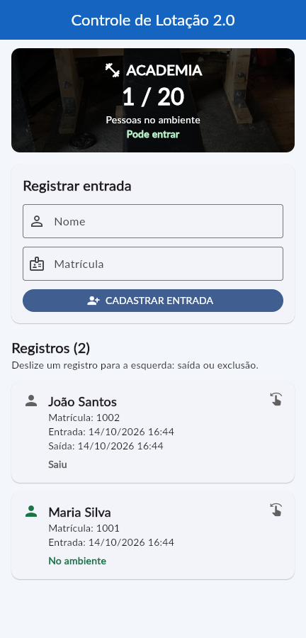

# Controle de Lotação 2.0 — Academia

Aplicativo Flutter do **Checkpoint 02 de Mobile Application Development**, evoluindo o controle de lotação do Checkpoint 01 para gerenciar as pessoas que entram e saem de uma academia.

**Ambiente escolhido:** academia com capacidade máxima de **20 pessoas**.

## Integrantes

- Murilo Marques — RM568224
- Erick Ramos — RM567837

## Demonstração

[▶ Assistir ao vídeo de demonstração](docs/demonstracao.mp4)

O vídeo mostra o aplicativo Flutter executando no navegador em tamanho de celular, com identificação do projeto e sem narração. Se o GitHub não exibir o player, use **View raw / Download** para abrir o MP4. Duração: aproximadamente **2 minutos e 37 segundos**.



## Funcionalidades

- Cadastro com nome, matrícula e data/hora automática.
- Lista de pessoas com matrícula, horário de entrada e situação.
- Total de pessoas presentes e aviso a partir de 16 pessoas.
- Bloqueio de novas entradas quando atingir 20 pessoas.
- Deslize um registro para a esquerda para acessar **SAÍDA** e **EXCLUIR**.
- Confirmação por diálogo antes de sair ou excluir.
- Mensagens de sucesso e validação por SnackBar.
- Data/hora de saída e bloqueio de saída repetida.
- Ícone personalizado de halter e fonte Lato incluída nos assets.

### Regras adotadas

O cadastro já registra a entrada. Nome e matrícula são obrigatórios. Espaços nas extremidades são removidos, e a comparação de matrícula ignora diferenças entre maiúsculas e minúsculas.

Duas pessoas com a mesma matrícula não podem estar **simultaneamente** no ambiente. Depois da saída, uma nova entrada com a mesma matrícula é permitida e gera um novo registro, preservando o anterior.

Excluir um registro de alguém presente libera a vaga, após confirmação. Excluir alguém que já saiu não muda a lotação. O contador é calculado a partir dos registros presentes, evitando valores negativos ou divergentes.

Os registros ficam **em memória**: fechar ou reiniciar o aplicativo limpa os dados. Não há login, servidor ou banco de dados nesta versão.

## Como executar

Pré-requisitos: Flutter SDK instalado e um dispositivo Android/emulador, ou Chrome. Projeto validado com **Flutter 3.47.7 / Dart 3.13.5**.

```bash
git clone https://github.com/erickramossantoser/mobile_academia.git
cd mobile_academia
git switch cp2-gerenciamento-acessos
flutter pub get
flutter run
```

Para testar pelo navegador:

```bash
flutter run -d chrome
```

No Android Studio ou VS Code, abra a **pasta do projeto**, escolha um dispositivo e execute `lib/main.dart`.

Se o Windows pedir suporte a links simbólicos e você só for usar Android/web, execute `flutter config --no-enable-windows-desktop` e tente `flutter pub get` novamente. Para usar Windows Desktop, habilite o Modo de Desenvolvedor do Windows.

Se o analisador Dart apresentar erro em um caminho com acentos, use uma pasta sem acentos, como `C:\projetos\mobile_academia`.

## Tecnologias e pacotes

| Tecnologia/pacote | Uso |
| --- | --- |
| Flutter / Dart | Interface e regras do aplicativo |
| `setState` | Atualização da tela quando os registros mudam |
| `flutter_slidable` | Ações laterais de saída e exclusão |
| `intl` | Datas no formato `dd/MM/yyyy HH:mm` |
| `google_fonts` | Fonte Lato, carregada dos assets |
| `flutter_launcher_icons` | Geração do ícone de inicialização |
| `flutter_test` / `flutter_lints` | Testes e análise de código |

A configuração dos pacotes está no `pubspec.yaml`, e as versões resolvidas estão no `pubspec.lock`.

## Organização

```text
lib/
  main.dart                # Inicialização, tema e fonte
  models/pessoa.dart       # Dados de cada registro
  screens/home_page.dart   # Cadastro, lista e regras
  widgets/pessoa_item.dart # Card com Slidable e funções recebidas
assets/
  images/                  # Imagem original da academia e ícone
  fonts/                   # Lato e licença
test/
  widget_test.dart         # Testes dos fluxos e regras
docs/
  demonstracao.mp4         # Vídeo para a entrega
  tela-aplicativo.png      # Captura real da interface
  EXPLICACAO.md            # Explicação simples do código
  ENTREGA.md               # Checklist e instruções de entrega
```

## Verificações

```bash
flutter analyze
flutter test
flutter build web
```

Validação local: análise de código sem problemas, 9 testes aprovados e build web concluído. A interface e os fluxos também foram conferidos no Chrome. A execução nativa em Android/iOS não foi testada neste computador.

Os 9 testes verificam cadastro obrigatório, data formatada, matrícula duplicada, capacidade, saída com confirmação, saída repetida, nova entrada após saída, exclusões e formulário com teclado em tela pequena.

Os ícones já estão gerados. Se mudar a imagem:

```bash
dart run flutter_launcher_icons
```

## Entrega

Veja o [checklist de entrega](docs/ENTREGA.md) e a [explicação do código](docs/EXPLICACAO.md).

A parte 2 está na branch `cp2-gerenciamento-acessos`, mantendo os commits da parte 1 no histórico.

## Créditos

A imagem de fundo foi mantida do projeto original. O ícone de halter foi desenhado para esta versão. A fonte [Lato, do Google Fonts](https://fonts.google.com/specimen/Lato) está distribuída conforme a licença em `assets/fonts/OFL.txt`.
